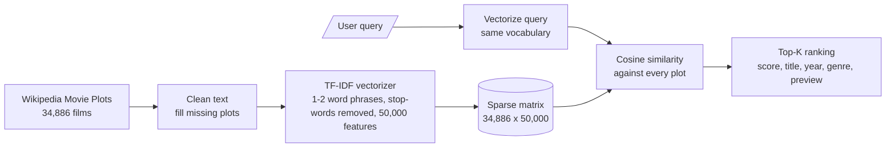

# 🎬 Movie Search Engine: Document Retrieval with TF-IDF

**Describe a film in plain English and get back the most relevant titles, ranked, from 34,886 Wikipedia movie plots.**


---

## ⚡ The 30-Second Summary

| | |
|---|---|
| **Problem** | Finding the right document in a large text collection when you only remember what it is *about*, not what it is called. |
| **Solution** | A search engine built on TF-IDF vectors and cosine similarity that ranks every film plot against a free-text query. |
| **Data** | 34,886 Wikipedia movie plots, 1901–2017, across 24 film origins (American, British, Bollywood, Tamil, Telugu, Japanese and more). |
| **Output** | Top-K results with rank, similarity score, title, year, genre and a plot preview. |
| **Speed** | About 0.16 s per query as written in the notebook; about 0.025 s after a one-line optimisation that returns identical rankings (see the review below). |
| **Honest verdict** | A solid, working keyword baseline. It also has clear, measured weaknesses, which are documented in this README rather than hidden. |

> **Why this matters beyond movies:** the same retrieval technique applies to product catalogues, internal knowledge bases, support-ticket triage and contract search. Lexical retrieval such as TF-IDF and BM25 remains a standard baseline and a common first stage in modern hybrid search and RAG systems. Understanding exactly where it works and where it fails is the first step to building something better.

---

## 🧠 How It Works



1. **Load and inspect.** Read the dataset, confirm there are no missing plots (0 of 34,886) and fill any NaN defensively.
2. **Vectorise.** `TfidfVectorizer` with English stop-word removal, unigrams plus bigrams (`ngram_range=(1, 2)`) and a 50,000-feature vocabulary.
3. **Score.** Convert the query into the same vector space and compute cosine similarity against every plot.
4. **Rank.** Sort and return the Top-K films through `search_movies()` and `display_results()`.

### Key numbers (measured on a re-run of the notebook)

| Metric | Value |
|---|---|
| Documents indexed | 34,886 |
| TF-IDF matrix shape | 34,886 × 50,000 |
| Vocabulary composition | 30,165 unigrams and 19,835 bigrams |
| Non-zero entries / density | 5,162,606 / 0.30 % |
| Matrix memory (sparse) | about 62 MB |
| Vectoriser fit time | about 38 s (single CPU, varies by machine) |
| Plot length | mean 372 words, median 284, range 2 to 6,752 |

---

## 🔎 Example Queries and Honest Readings

Real output from the notebook (top three shown; the notebook prints top five):

| Query | Rank 1 | Rank 2 | Rank 3 | Reading |
|---|---|---|---|---|
| `artificial intelligence robot destroys humanity` | Armed Response (2017), 0.3057 | Daft Punk's Electroma (2006), 0.2959 | Solar Crisis (1990), 0.2796 | ✅ Strong match on the *vocabulary* (AI, robots). It matches the words, not the "destroys humanity" intent. |
| `time travel science fiction thriller` | Chhalia (1973), 0.4105 | Haathkadi (1982), 0.2969 | Remote Control (1988), 0.2871 | ⚠️ Weak. The top two plots are only 5 and 6 words long, and none of the top five mentions time travel. |
| `comedy and horror` | I Was a Teenage Zombie (1987), 0.4420 | The Moon's Our Home (1936), 0.2952 | Yellow Sands (1938), 0.2950 | ✅ Rank 1 is an excellent horror comedy. ⚠️ Ranks 2 to 5 are comedies without a horror tag. |
| `comedy/drama` | Lal Dupatta Malmal Ka (1989), 0.4771 | Nothing Else Matters (1920), 0.4021 | I Was a Teenage Zombie (1987), 0.3058 | ⚠️ Matches the literal words inside plot text, not the `Genre` field. |

---

## 🛠️ Engineering Review: What I Found When I Audited My Own Work

I re-ran the full pipeline on the original CSV, reproduced every saved output exactly, and then tested the weak spots. These are the findings, with evidence.

| # | Finding | Evidence | Suggested fix |
|---|---|---|---|
| 1 | **Short-plot bias.** Very short plots can outrank genuinely relevant long ones. | For the time-travel query, the top five plots have 5, 6, 39, 60 and 44 words (corpus median: 284). None mentions time travel, although 118 plots mention time travel, a time machine or travelling back in time. | BM25 (explicit length normalisation), `sublinear_tf=True`, or a minimum plot-length filter. |
| 2 | **The `Genre` column is never searched.** Only `Plot` is indexed, so genre-style queries match incidental words. | For `comedy and horror`, only rank 1 carries a horror tag in `Genre`, yet 154 films are tagged with both comedy and horror. 17.4 % of rows (6,083) have `Genre = unknown`, and the field uses inconsistent labels (`comedy/drama`, `comedy / romance`, `thriller, sci-fi, action`). | Normalise genres into a multi-label field and combine it with plot similarity (metadata filter or field boosting). |
| 3 | **The 50,000-feature cap discards about 99 % of candidate terms.** | Without the cap the same settings produce 4,449,982 unigram and bigram features. `max_features` keeps the most frequent terms, so rarer words and phrases can never be matched. | Use `min_df` / `max_df` pruning instead of a hard cap, or test a larger cap. |
| 4 | **Slower than necessary.** `cosine_similarity` repeats normalisation that `TfidfVectorizer` has already applied. | Replacing it with the sparse product `(tfidf_matrix @ query_vec.T).toarray().ravel()` took about 25 ms versus about 160 to 190 ms, with the same top five and a maximum score difference of 1.7e-16. | Use the sparse dot product (and `np.argpartition` for Top-K). |
| 5 | **Cosmetic bug: the preview always ends in `...`.** | `[:500] + "..."` is applied even to plots of 500 characters or fewer (5,820 films, 16.7 %), producing outputs such as `Chhalia is a family thriller....`. | Append the ellipsis only when `len(plot) > 500`. |
| 6 | **Latent bug (dormant).** The matrix is built from the NaN-safe `plots` list, but the preview reads `df.iloc[i]["Plot"][:500]`. | It would raise a `TypeError` on a missing plot. It never triggers because this dataset has 0 missing plots. | Read from `plots[i]` instead. |
| 7 | **Duplicate content in a "deduped" file.** | 1,017 rows share an exact plot string with an earlier row, so identical text can occupy several result slots. | De-duplicate on `Plot` before indexing. |
| 8 | **No quantitative evaluation.** | Quality is judged on four hand-picked queries. There are no relevance labels, so there is no precision@k, MRR or nDCG. All quality statements here are qualitative. | Build a small labelled query set (genre tags can serve as weak labels) and report precision@k and nDCG. |
| 9 | **Reproducibility.** | The data path points to a private Google Drive folder and requires `drive.mount`. `import pandas as pd` appears twice, and there is no `requirements.txt`. | Use a relative `data/` path, add dependencies and de-duplicate imports. |

*Timings come from a single-CPU re-run and will differ by machine. All counts come from the supplied CSV.*

---

## 💼 What This Project Demonstrates

| Capability | Evidence in this project |
|---|---|
| Information-retrieval fundamentals | TF-IDF weighting, cosine similarity and Top-K ranking, implemented end to end. |
| Text feature engineering | Unigram and bigram features, stop-word handling, and a quantified vocabulary trade-off. |
| Working with sparse data | A 34,886 × 50,000 matrix at 0.30 % density, handled in about 62 MB. |
| Data validation | Missing-value checks and schema inspection before modelling. |
| Critical evaluation | Failure modes found, measured and documented with fixes. |
| Engineering judgement | Identified a performance optimisation that keeps rankings identical. |

---

## 🚀 Quick Start

```bash
# 1. Download or clone this repository, then install dependencies
pip install pandas numpy scikit-learn jupyter

# 2. Download the dataset (see "Data" below) and save it as:
#    data/wiki_movie_plots_deduped.csv

# 3. Launch the notebook
jupyter notebook Document_Retrieval.ipynb
```

In the notebook, skip the Google Drive cell and set:

```python
drive_path = "data/wiki_movie_plots_deduped.csv"
```

Then search:

```python
results = search_movies("a detective investigates a murder in a small town", top_k=5)
display_results(results)
```

---

## 🗺️ Roadmap

- [ ] Switch to BM25 or `sublinear_tf` to reduce short-plot bias
- [ ] Index and normalise the `Genre` field (hybrid plot and metadata ranking)
- [ ] Add a labelled evaluation set with precision@k and nDCG
- [ ] Compare against semantic retrieval (Word2Vec, Doc2Vec, sentence-transformer embeddings with a vector index)
- [ ] Wrap the search function in a small web demo (Streamlit or FastAPI)

---

## 📁 Repository Structure

```
.
├── Document_Retrieval.ipynb   # Full implementation and test queries
├── README.md                  # You are here
└── data/                      # Not committed (see below)
    └── wiki_movie_plots_deduped.csv
```

## 📚 Data

**Wikipedia Movie Plots** on Kaggle: <https://www.kaggle.com/datasets/jrobischon/wikipedia-movie-plots>. It contains 34,886 films with release year, title, origin, director, cast, genre, Wikipedia URL and plot text.

The CSV is about 81 MB, so it is **not included** in this repository. Plot text originates from Wikipedia; please check the Kaggle page for the dataset's current licence terms before redistributing it.

---

## 👤 Author

**Vishnusai Vydhyam**: B.Tech in Computer Science Engineering (AI & ML), Mohan Babu University, Tirupati (Class of 2027).
Open to **Machine Learning, Data Science and AI Engineer** internship and fresher roles.

[](https://github.com/vishnusai2005)
[](https://www.linkedin.com/in/vishnusai-vydhyam)

*If this project was useful or interesting, a ⭐ is appreciated.*
